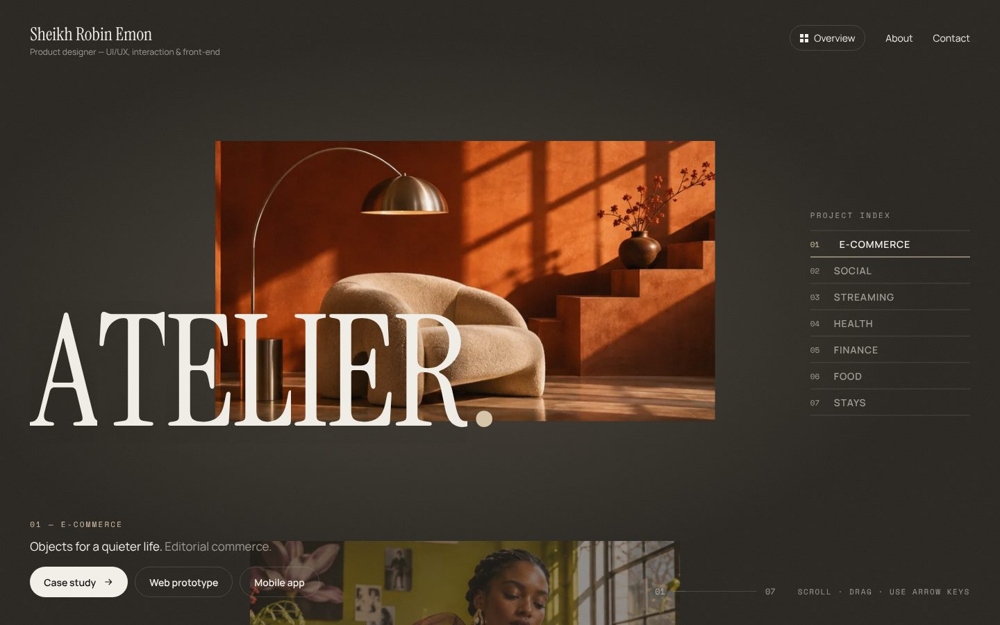

# Sheikh Robin Emon · UI/UX Portfolio

**Live site: https://sheikhrobinemon-usf.github.io/UIUXPortfolio/**

Seven product-design case studies. Every one ships with a **complete, interactive web app and a native-style mobile app** that share the same data — add something on the phone and it appears on the web.



## View it

- **Online:** https://sheikhrobinemon-usf.github.io/UIUXPortfolio/
- **A project directly:** `…/UIUXPortfolio/work/<slug>/` for the case study, `…/UIUXPortfolio/play/<slug>/?view=web` or `?view=mobile` for the prototypes.
- **On your computer:** the site in this folder is built for the `/UIUXPortfolio/` path, so serve the repository's parent folder (for example `npx serve ..` from the repository) and open `/UIUXPortfolio/`, or run the source locally (below).

| Slug | Product | Web | Mobile app |
| --- | --- | --- | --- |
| [ecommerce](https://sheikhrobinemon-usf.github.io/UIUXPortfolio/work/ecommerce/) | ATELIER · Editorial commerce | Shop, filters, product detail, bag, 3-step checkout, tracking, returns | Stories, search, option sheet, swipe-to-pay, orders |
| [social](https://sheikhrobinemon-usf.github.io/UIUXPortfolio/work/social/) | COMMON · Creative communities | Onboarding, feed scopes, critique posts, polls, composer, circles, DMs | Stories, double-tap like, comment sheet, create tab, chat |
| [streaming](https://sheikhrobinemon-usf.github.io/UIUXPortfolio/work/streaming/) | FRAME · Cinematic discovery | Profiles, autoplay hero, hover previews, episodes, custom player | New & Hot, vertical clips, downloads, landscape player |
| [health](https://sheikhrobinemon-usf.github.io/UIUXPortfolio/work/health/) | VITAL · Personal wellness | Rings, heart, sleep stages, nutrition, breathing, habits, trends, journal | Live workout, breathing, water, habits, night-mode sleep |
| [finance](https://sheikhrobinemon-usf.github.io/UIUXPortfolio/work/finance/) | MONETA · Personal finance | Net worth, transactions, budgets, subscriptions, goals, cards, transfers | Keypad pay with Face ID step, card carousel, plan |
| [food](https://sheikhrobinemon-usf.github.io/UIUXPortfolio/work/food/) | CRAVE · Local food delivery | Scroll-synced menu, required options, fees, live tracking, chat, rating | Collapsing header, dish sheet, cart bar, swipe to order, map sheet |
| [stays](https://sheikhrobinemon-usf.github.io/UIUXPortfolio/work/stays/) | ROAM · Slow travel & stays | Range calendar, linked map/list, price histogram, booking, trips, wishlists | Stepped search, map rail, swipe galleries, reserve bar, trips |

## What is in it

- **WebGL project slider.** A hand-written WebGL renderer bends each project plane with scroll velocity, splits colour channels in motion and ripples under the pointer. Wheel, drag, swipe and arrow keys; `G` opens an overview grid.
- **Cinematic transitions.** A loader tied to real image loading, letter-by-letter titles, a colour wash per project, a custom cursor and an image that expands into the case study.
- **Case studies** with smooth scroll, scroll-lit text, both prototypes embedded live, a pinned journey of every flow, key screens, wireframes, the visual system, and a scroll-to-continue handoff to the next project.
- **Fourteen apps.** Each product has its own brand, type and motion language, and a web and mobile app with long, complete flows. Fictional data lives in the browser; **Reset demo** restores it.
- **Accessible and responsive.** Keyboard support, labelled controls, reduced-motion fallbacks, and layouts tested from 320 to 1920 px.

## Folder structure

```
/                 ← the published static site (served by GitHub Pages)
  index.html, 404.html, .nojekyll, _next/, media/, fonts/
  work/<slug>/    case studies
  play/<slug>/    web + mobile prototypes
  about/, contact/
source/           ← Next.js source (app/, components/, lib/, public/, scripts/, tests/)
docs/             ← plan, research, design systems, status, validation
```

## Edit and publish

```sh
cd source
npm ci
npm run dev        # http://localhost:3000
npm run publish    # builds and replaces the site at the repository root
```

Commit and push the result to `main`; GitHub Pages (Settings → Pages → Deploy from a branch → `main` / `(root)`) serves it.

Tests: `npm run test:static` and `npm test` (Playwright) from `source/`. See [validation](docs/VALIDATION.md).

## Documentation

- [Master plan](docs/MASTER_PLAN.md) · [Reference analysis](docs/REFERENCE_ANALYSIS.md) · [Product design research](docs/PRODUCT_DESIGN_RESEARCH.md)
- [Design systems](docs/DESIGN_SYSTEM.md) · [Project status](docs/PROJECT_STATUS.md) · [Validation](docs/VALIDATION.md)

## Licence

MIT for the code. Fonts are OFL (licences in `source/public/fonts/`). All data and people in the prototypes are fictional.
